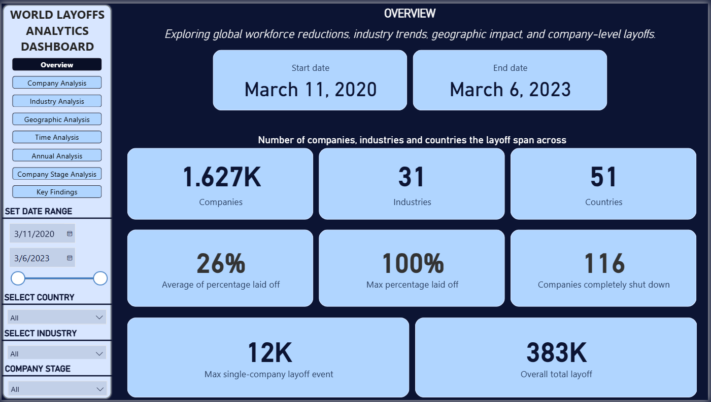
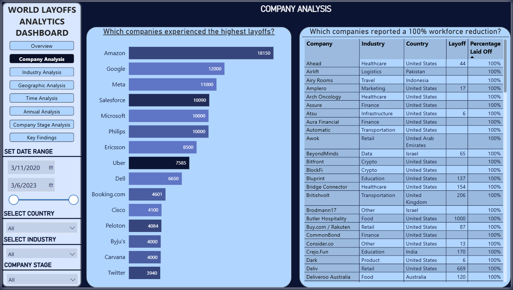
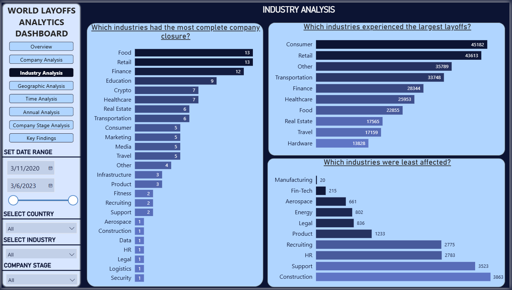
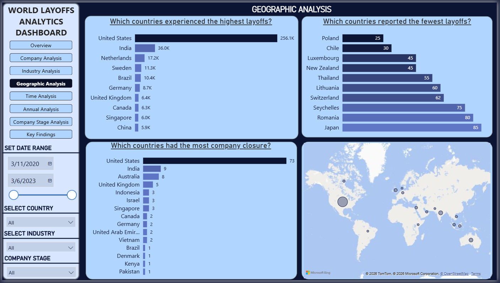
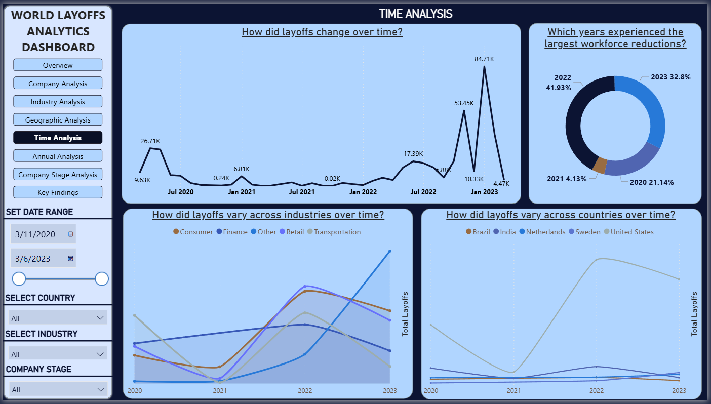
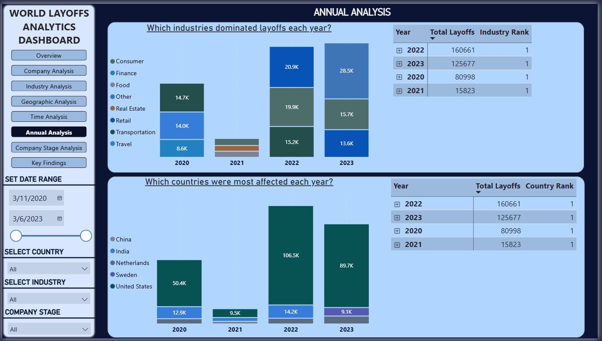
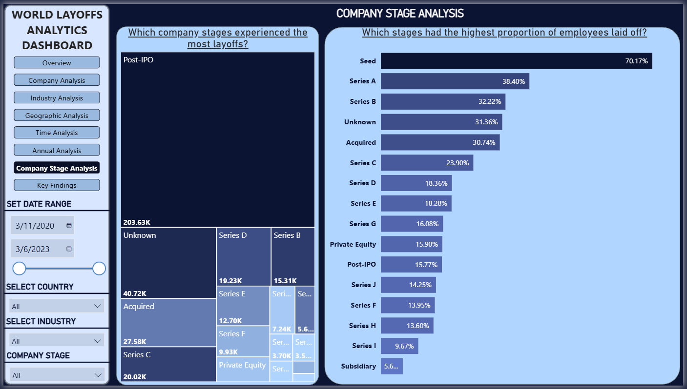
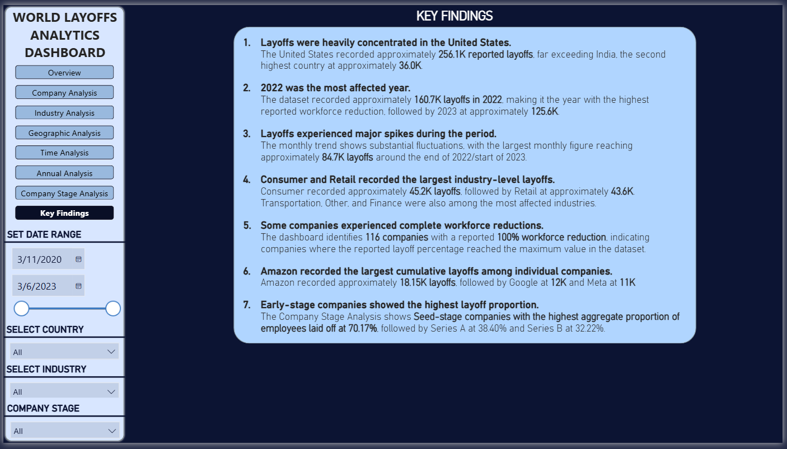

# World Layoffs Analytics Dashboard (Power BI)

## Project Overview

This project presents an interactive Power BI dashboard visualizing global workforce reductions from March 2020 to March 2023. Building upon the cleaned and analyzed dataset from my previous SQL projects, this dashboard transforms query results into a visual, interactive tool for exploring layoff trends across companies, industries, countries, funding stages, and time.

The goal is to provide a clear, high-level view of the data—allowing users to filter, drill down, and quickly identify the most affected sectors and companies during this period.

## Dashboard Pages

The report is structured into eight distinct pages to guide the user through the analysis:

1.  **Overview:** Key performance indicators (KPIs) summarizing the dataset—total layoffs (383K), total companies (1.6K), date range, and the number of companies with 100% workforce reduction (116).

3.  **Company Analysis:** Highlights the top companies by total layoffs (e.g., Amazon at 18.15K, Google at 12K) and lists companies that reported a 100% workforce reduction.

5.  **Industry Analysis:** Compares industries by total layoffs (Consumer and Retail leading), and identifies industries with the most complete company closures.

7.  **Geographic Analysis:** Displays the geographic distribution of layoffs, showing the United States as the most affected country (256.1K), alongside a map visual and a list of countries with the fewest layoffs.

9.  **Time Analysis:** Tracks how layoffs fluctuated over time, highlighting the major spikes in late 2022 and early 2023, with a breakdown of yearly percentages.

11.  **Annual Analysis:** Shows the dominance of specific industries and countries year by year, noting 2022 as the most impacted year (160.7K layoffs).

13.  **Company Stage Analysis:** Uses a treemap and bar chart to reveal that Post-IPO companies had the highest total layoffs, while Seed-stage companies had the highest proportion of their workforce laid off (70.17%).

15.  **Key Findings:** A summary page outlining the seven most important insights drawn from the data.

## Key Insights

*   **Concentration of Impact:** The United States recorded approximately **256.1K** layoffs, far exceeding the second-highest country (India at 36K).
*   **The Worst Year:** **2022** was the most affected year, with approximately **160.7K** layoffs, followed by 2023 (125.6K) despite the data covering only the first three months of that year.
*   **Industry Leaders:** The **Consumer** (45.2K) and **Retail** (43.6K) industries experienced the largest volume of layoffs.
*   **Complete Shutdowns:** The dashboard identifies **116 companies** that reported a 100% workforce reduction.
*   **Company-Level Impact:** **Amazon** recorded the largest cumulative layoffs at approximately **18.15K**, followed by Google (12K) and Meta (11K).
*   **Funding Stage Dynamics:** While Post-IPO companies had the highest total layoffs, **Seed-stage** companies experienced the highest proportion of employees laid off at **70.17%**.

## Data Source & Context

**Source:** [Kaggle – World Layoffs Dataset](https://www.kaggle.com/datasets/swaptr/layoffs-2022)

This dashboard is the final step in a three-part project workflow:
1.  [World Layoffs Data Cleaning](https://github.com/joelokolie/world-layoffs-data-cleaning) (SQL)
2.  [World Layoffs Analysis](https://github.com/joelokolie/world-layoffs-analysis) (SQL)
3.  **World Layoffs Analytics Dashboard** (Power BI) *Current Project*

## Tools Used

| Tool | Purpose |
| :--- | :--- |
| **Power BI Desktop** | Data modeling, DAX measures, and interactive visualization |
| **SQL (MySQL)** | Data extraction and prior data cleaning |
| **Git & GitHub** | Project documentation and hosting |

## Author

**Joel Chukwudi Okolie**
Aspiring Data Analyst
*   **GitHub:** [https://github.com/joelokolie](https://github.com/joelokolie)
*   **LinkedIn:** [https://www.linkedin.com/in/joel-okolie](https://www.linkedin.com/in/joel-okolie)

